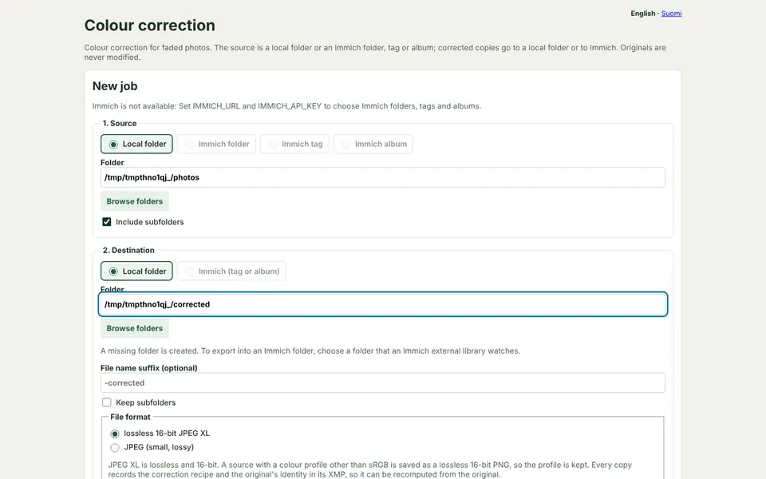

# unfade

Colour correction for faded photos, for a local folder or an [Immich](https://immich.app) library.



<sub>Demo photos: CC0 landscapes from Wikimedia Commons, faded for the demo ([credits](docs/demo-photos/CREDITS.md)). `uv run --group e2e python docs/make_demo.py` records the animation again.</sub>

- Three automatic methods (FADE, GWG, PCS), fitted on each image separately, with per-image strength, black point, white point and temperature on top.
- A web UI to group images, compare methods side by side, see clipping, histograms and ΔE, and approve group by group.
- Lossless 16-bit output (JPEG XL, or PNG for non-sRGB sources). The full correction recipe is embedded in the copy's XMP, so the copy can be recomputed from the original pixel for pixel.
- In Immich, copies are stacked with their originals, or replace them. Copies inherit albums, tags, favourite, rating, description, date and location.
- An archive of originals that outlives both this tool and Immich: originals byte for byte, Immich's metadata as standard XMP sidecars, references to every corrected copy with its recipe, and a snapshot of the code that made them.
- Built to survive dropped connections and interrupted uploads and downloads.

The user interface is in English and Finnish.

## Quick start

Requires Python 3.14 and [uv](https://docs.astral.sh/uv/).

```bash
cp .env.example .env              # set IMMICH_URL and IMMICH_API_KEY to use Immich
uv run --env-file .env python -m unfade serve        # http://127.0.0.1:8001
```

Or from the command line, without approving groups:

```bash
uv run --env-file .env python -m unfade run --source immich-tag:Albums/1978 --dest immich --dest-tag Korjattu
uv run python -m unfade run --source local:~/scans --recursive --dest local:~/corrected --suffix=-unfaded
```

Sources: `local:PATH` (with `--recursive` for subfolders), `immich-folder:PATH`, `immich-tag:NAME` or `immich-album:NAME`.
Destinations: `local:PATH` or `immich` (with `--dest-tag` and/or `--dest-album`).
Immich picks the storage path of an upload itself, so to write into a folder that an Immich external library watches, choose that folder as a local destination.

## Correction

- **Methods** (details and sources in [docs/methods.md](docs/methods.md)):
  - **FADE** (default): a dye-fade model with a power curve per channel, after Geoff Daniell. It clips the least.
  - **GWG**: a per-channel stretch plus grey-world gamma. It removes any colour cast.
  - **PCS**: a per-channel stretch only. It keeps the original's overall tone.
- **Groups:**
  - A group decides the method. Each image is still fitted on its own, and its own adjustments go on top.
  - Groups are proposed from the source's folders. In a folder of at least five images, strong brightness or colour outliers get a review group of their own.
  - Drag images between groups; Undo and Redo work.
- **Approval:**
  - Groups are approved one at a time, and export writes only approved groups.
  - Changing a method, an adjustment or a group's members withdraws the approval.
  - `run` exports every proposed group without approval.
- **Re-export:** images whose method and adjustments have not changed are skipped.
- **Originals are never written.** A local destination cannot be the source folder unless a suffix is given.

## Output and the recipe

- **Formats:**
  - The default is a lossless 16-bit JPEG XL.
  - The correction is computed at the original's own bit depth (16-bit TIFF and PNG stay 16-bit) and never rounded to 8 bits.
  - A source with a non-sRGB ICC profile gives a lossless 16-bit PNG, so the profile is kept.
  - `--format jpeg` gives 8-bit JPEG at quality 95 when small files matter.
- **Metadata:** EXIF, ICC profile and the source's XMP are kept. EXIF orientation is applied to the pixels.
- **Recipe:** the copy's XMP (namespace `https://github.com/ssalonen/unfade/ns/recipe/1.0/`) records:
  - the method, the fitted curve parameters and the adjustments
  - the code version: a digest of the files that decide the pixels, plus the git commit
  - about the original: name, path, size in bytes and SHA-256
  - the original's pixel digest: SHA-256 of the decoded RGB samples as stored, before orientation, as 16-bit little-endian. It stays the same when only the metadata changes.
  - the original's pixel format and EXIF orientation
  - the original's SHA-1 (Immich's own checksum)
  - pHash and dHash of both the original and the copy. They are computed as the `imagehash` library does and survive recompression and resizing.
  - the copy's own UUID (`xmpMM:DocumentID`) and a stable id for the original. In Immich that id is kept in the asset's metadata, so the file is not changed.
- **Reversibility:** the copy itself cannot be turned back into the original, because the black and white points and saturation clip on purpose. But the original plus the recipe recompute the copy exactly.

## Immich

- **The original**, when correcting from Immich into Immich, does one of three things:
  - It is stacked with the copy, copy on top (the default). A later export merges into the same stack.
  - It is replaced by the copy (`--replace-original`):
    - The copy takes over the original's albums, tags, shared links, stack, favourite, rating, description, date and location, using Immich's own `PUT /assets/copy` and the API.
    - The original goes to Immich's trash. An original in an external library is never trashed, since Immich would not delete its file and the next library scan would bring it back.
  - It is left separate (`--no-stack`).
- **Details:**
  - Stacking alone moves no albums, tags or edited details. So by default the copy gets the original's albums, tags, favourite, rating, description, date (in the original's time zone) and location.
  - Anything that could not be copied, such as a shared album without add permission, shows up as an export warning.
  - People are detected again on the copy by Immich's face recognition.
- **Recognising copies:** copies are recognised from their Immich metadata and skipped when a source is read, so they are never corrected twice. This needs Immich v2.5 or later.
- **`--replace-previous`** moves earlier copies of the same original to the trash after a new export. Only assets whose metadata says they are this tool's copies of that original are touched.
- **API key:** the key needs permission to read assets, folders, tags and albums, and to upload assets, create tags, add assets to tags and albums, and manage stacks.

## Archive of originals

```bash
uv run --env-file .env python -m unfade archive --source immich-tag:Albums/1978 --to /tank/archive
uv run python -m unfade verify /tank/archive
```

```
archive/
  originals/<name>          the original, byte for byte (Immich's SHA-1 checked)
  originals/<name>.xmp      Immich's metadata as a standard XMP sidecar
  originals/<name>.json     the complete record
  code/unfade-<code id>/    the correction code that made a copy, file for file
  code/recompute.py         original + recipe → the copy's pixels
  index.html, index/        offline overview by tag, album and year
  manifest.json, SHA256SUMS, README.md
```

- **Names:**
  - Immich sources give one flat folder with the original file names. Local sources keep their subfolders.
  - A name is fixed on first archiving. A clash with other content gets the start of the SHA-256.
- **XMP sidecar:**
  - standard fields: description, tags (`dc:subject`, `digiKam:TagsList`), rating, date with time zone, GPS, and named people as MWG face regions
  - plus albums, favourite, archive, trash and shared-link state, digests, and every corrected copy with its recipe
  - Immich reads the sidecar back, people included when face import from metadata is on.
- **Copies are referenced, not stored.** `code/recompute.py` rebuilds a copy's pixels from the original and its recipe, using the archived code snapshot whose files hash to the recorded code id.
- **Trash:** Immich tag and album sources include originals already in the trash, so archive before the trash is emptied after a replace.
- **Safety:**
  - Runs only add.
  - An archived original that no longer matches its digest stops the run.
  - The archive refuses a non-empty foreign folder, or nesting with its source.
  - `verify` checks `SHA256SUMS`, same as `sha256sum -c`.

## Dropped connections

- **Retries:** a failed, timed-out or overloaded request (408, 429, 5xx) is retried with growing pauses: 0.5 s, 1 s, 2 s and so on, at most 30 s, 8 attempts. `Retry-After` is honoured. Other errors are reported at once.
- **Stalls:** a stalled connection is dropped after two minutes without data and retried.
- **Downloads** are checked against Content-Length and Immich's checksum. A broken download is fetched again from the start and never used.
- **Uploads:**
  - An upload cut off part-way creates nothing in Immich and is sent again.
  - If the answer to a finished upload is lost, or the app stops, the copy's UUID was already saved. The next attempt builds byte-identical content, which Immich recognises as a duplicate, so no duplicates are made.
  - An export stopped part-way shows as interrupted and continues where it left off.
- **Archive runs** save their manifest along the way and resume. An original copied in but not yet listed is adopted when its digest matches.
- **Previews** in the browser are retried twice.

## Configuration

| Variable | Meaning |
| --- | --- |
| `IMMICH_URL`, `IMMICH_API_KEY` | Immich server and API key |
| `UNFADE_ROOTS` | Local folders the web UI may browse, separated by `:` (default: home directory). The web UI has no login, so keep it on localhost. |
| `UNFADE_DATA_DIR` | Jobs and cached originals (default `./data/unfade`) |
| `UNFADE_RETRY_ATTEMPTS`, `UNFADE_RETRY_BASE` | Retry count and first pause in seconds |
| `UNFADE_LANG` | `en` or `fi` for the command line and the archive's README and index (default: from `LANG`, else English) |

The web UI follows the browser's language; the English · Suomi switch at the top of each page overrides it and is remembered in a cookie.

Lossless copies are large: a grainy 24-megapixel scan is easily tens of megabytes.

## Tests

```bash
uv run pytest                      # unit tests (Node.js needed for the preview parity test)
uv sync --group e2e
uv run --group e2e playwright install chromium
uv run --group e2e pytest e2e      # end-to-end, needs Docker
```

- **What the end-to-end tests do:**
  - start a throwaway Immich (server, Postgres, Valkey; pinned versions in `e2e/docker-compose.yml`)
  - create a user per test, seed images, tags, albums and details, and run the tool
  - check the result through Immich's API and, with Playwright, through Immich's web UI and this tool's own
  - pass the traffic through a fault-injecting proxy that cuts transfers part-way and blocks connections for a few seconds
- **Artifacts:** screenshots go to `e2e/artifacts/`.
- **Teardown:** containers and volumes are removed afterwards, also when the run is cancelled.
- **Options:**
  - `IMMICH_VERSION=v2.5.0` tests another Immich version.
  - `UNFADE_E2E_KEEP=1` leaves the server running.
  - `UNFADE_E2E_URL` uses a running test server.
  - `UNFADE_E2E_CHROMIUM` points Playwright at an existing Chromium instead of its own download.
  - Without Docker the tests are skipped.

## Translations

User-facing text is written in English and wrapped in `t()` in Python, the templates and the browser scripts. The Finnish translations are in `unfade/locale_fi.py`, keyed by the English text. `tests/test_i18n.py` fails when a text has no translation, a translation is unused, or a placeholder differs.

## License

MIT. The correction methods are published algorithms by others; see [docs/methods.md](docs/methods.md) for credits. This implementation was written from their published descriptions.
